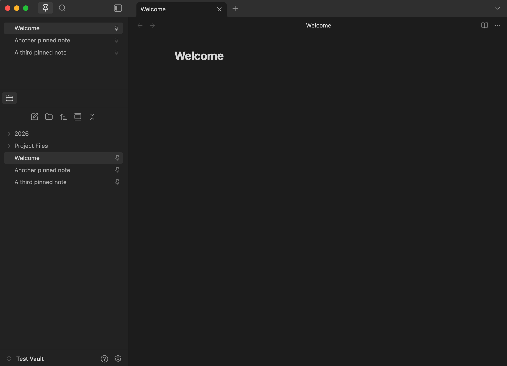

# Pinned Files

A simple Obsidian plugin for pinning important files so they are always easy to find.

Pinned Files adds a compact Pinned Files view to the sidebar. It is designed to feel native to Obsidian: pinned items use the same compact styling as native file rows, pinned files open with one click, and matching files in the native File Explorer get a subtle pin indicator.

## Screenshot

## Features

- Pin files from the command palette or File Explorer context menu.
- View pinned files in a compact sidebar list.
- Open pinned files with one click.
- Cmd/Ctrl-click to open in a new tab.
- Right-click a pinned item to unpin it.
- Drag and drop pinned rows to reorder them (desktop).
- See subtle pin indicators in the native File Explorer.
- Optionally list your pinned files on the new tab page, as their own list or as buttons beside New note and Go to file.
- Set your own text for the sidebar title and the new tab heading.
- Handles renamed or deleted pinned files automatically.
- Supports Obsidian Sync by periodically reloading its own plugin data.

## What this plugin does not do

- It does not replace or rebuild Obsidian's File Explorer.
- It does not manage sidebar layout.
- It does not implement search.
- It does not use bookmarks or frontmatter as the source of truth.
- It does not modify vault file contents.

## Installation

### Manual installation from a GitHub release

1. Download `manifest.json`, `main.js`, and `styles.css` from the latest release on the [GitHub Releases page](https://github.com/mattmaiorana/pinned-files/releases).
2. Inside your vault, create the folder `.obsidian/plugins/pinned-files/`.
3. Copy the three files into that folder.
4. Reload Obsidian and enable **Pinned Files** in **Settings → Community plugins**.

### From source

1. Clone this repository.
2. `npm install`
3. `npm run build`
4. Copy `manifest.json`, `main.js`, and `styles.css` into the `.obsidian/plugins/pinned-files/` folder inside your vault.
5. Enable the plugin in **Settings → Community plugins**.

## Usage

- Open the Pinned Files view from the command palette (**Pinned Files: Open view**) or the ribbon pin icon.
- Right-click a file in the native File Explorer → **Pin file** / **Unpin file**.
- Click a pinned row to open the file. Cmd/Ctrl-click to open it in a new tab.
- Right-click a pinned row in the Pinned Files view → **Unpin**.
- Drag a pinned row up or down to reorder it (desktop only).
- Hover a pinned row for a moment to see the file's full vault path in a tooltip.

## Settings

- **Add pinned files to sidebar on startup**: adds the Pinned Files view to the left sidebar when Obsidian starts. It will not steal focus from your active sidebar tab.
- **Show section title**: shows a small title above the pinned rows in the sidebar. On by default.
  - **Section title**: the title's text. Defaults to "Pinned Files"; leave it blank to go back to that.
  - **Subtle title**: a smaller, quieter title shown exactly as typed, instead of the bold all-caps one. Off by default.
- **Show pinned files on new tabs**: lists your pinned files on Obsidian's new tab page, so one click from a new tab opens any of them in that tab. Off by default. When on:
  - **Show heading on new tabs**: a heading above them. On by default.
  - **New tab heading**: the heading's text. Defaults to "Pinned Files"; leave it blank to go back to that.
  - **Show as a separate list**: your pinned files as their own list below the new tab buttons. Off: one button per file, mixed in with Obsidian's own. On by default.
- **Clear pinned files**: removes every entry from the pinned list. This only clears the plugin's record; it does not delete the files themselves.

## Obsidian Sync

Pinned files are stored in the plugin's own `data.json`. If Obsidian Sync is configured to sync plugin data, your pinned list will sync between devices. The plugin periodically reloads its own data so synced changes appear without restarting Obsidian.

## Data safety

This plugin is intentionally conservative about what it touches.

- It does not create, delete, rename, move, or modify any notes, attachments, folders, frontmatter, or bookmarks.
- The only file it ever writes is its own settings file at `.obsidian/plugins/pinned-files/data.json` inside your vault.
- Rename and delete handlers only update stored pin paths after Obsidian reports that a file or folder has changed. They never originate a vault change.
- Native File Explorer pin indicators are decoration only and do not interfere with native click, right-click, or drag behavior.

## Development

- `npm run dev` — watch-mode build
- `npm run build` — production build (type-checks then bundles)
- `npm run lint` — Obsidian's review rules (`eslint-plugin-obsidianmd`)

## Release files

For manual installation, users only need these three files from a GitHub release:

- `manifest.json`
- `main.js`
- `styles.css`

## Status

v1.2.0 — stable. See [CHANGELOG.md](CHANGELOG.md) for release notes and [FUTURE_PLANS.md](FUTURE_PLANS.md) for ideas under consideration.

## License

[MIT](LICENSE) © Matt Maiorana
